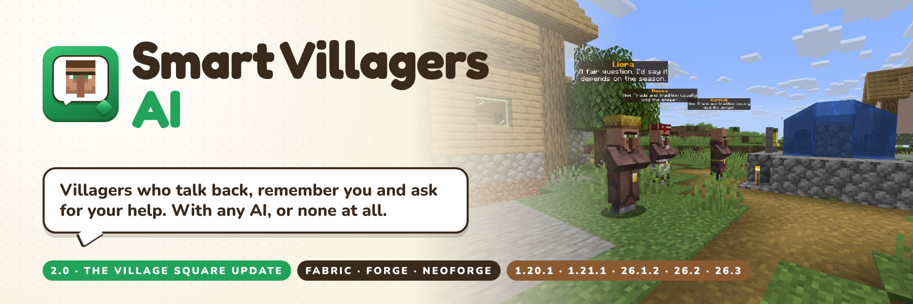

# Smart Villagers AI



Villagers you can talk to, who remember you and ask for your help. Stand near a villager and chat normally: it
answers in a speech bubble above its head, in character, with an AI provider of your choice (cloud, local model or
any OpenAI-compatible endpoint) or with built-in dialogue when there is none.

**2.0 "The Village Square Update"** turns conversation into gameplay: village requests with real rewards, vanilla
reputation and gossip, speech bubbles, and Minecraft 26.1.2. See the [2.0.0 notes](patchnotes/2.0.0.md) and the
[design notes](docs/DESIGN-2.0.md).

## Which jar do I download?

Jar names are `smartvillagers-{loader}-{minecraft}-{modVersion}.jar`. Match **both** the Minecraft version and the
loader. Install it on the server, or in your game for single player.

| Minecraft | Java | Fabric jar (needs Fabric API) | Forge jar | NeoForge jar |
|-----------|------|-------------------------------|-----------|--------------|
| 1.20.1 | 17+ | `smartvillagers-fabric-1.20.1-2.0.0.jar` | `smartvillagers-forge-1.20.1-2.0.0.jar` (Forge 47) | — |
| 1.21.1 | 21+ | `smartvillagers-fabric-1.21.1-2.0.0.jar` | `smartvillagers-forge-1.21.1-2.0.0.jar` (Forge 52) | `smartvillagers-neoforge-1.21.1-2.0.0.jar` |
| 26.1.2 | 25+ | `smartvillagers-fabric-26.1.2-2.0.0.jar` | — | `smartvillagers-neoforge-26.1.2-2.0.0.jar` |
| 26.2 | 25+ | `smartvillagers-fabric-26.2-2.0.0.jar` | — | `smartvillagers-neoforge-26.2-2.0.0.jar` (NeoForge 26.2.0.93 or newer) |
| 26.3 | 25+ | `smartvillagers-fabric-26.3-2.0.0.jar` | — | `smartvillagers-neoforge-26.3-2.0.0.jar` (NeoForge 26.3.0.97 or newer) |

Optional on every build: [Simple Voice Chat](https://modrinth.com/plugin/simple-voice-chat) (server and clients) to
hear villagers speak.

## Features

- **Proximity chat**: no commands needed. A villager answers when you look at it, say its name, greet it, ask a
  question or stand close. Messages that name another online player are left alone.
- **Speech bubbles**: the reply floats above the villager who said it ("..." while the AI is thinking). Built from a
  vanilla text display that rides the villager, so everyone nearby sees it.
- **Village requests**: ask "any work for me?" (or "need help?", "¿tienes trabajo?", "as-tu une quête ?"...). Each of
  the 13 professions wants its own things, and about a third of requests are monster hunts. Accept by saying yes or
  clicking [Accept], then come back when it's done: emeralds, XP, vanilla positive gossip (better prices) and a
  favour in the world's ledger.
- **Reputation and gossip**: villagers read vanilla reputation. Hurt one and it will not give you work (and, as in
  vanilla, its gossip about you spreads to its neighbours). Neighbours within 48 blocks hear about a finished request
  and bring it up. Ten favours make you a hero to every villager in that world.
- **Advancements**: Smart Villagers (talk to a villager), A Favor for a Friend (finish a request), Hero of the Village
  Square (finish ten).
- **Personalities**: every villager gets a stable name, trait, speech style and backstory, shown as a name tag;
  operators (or everyone, if allowed) can edit them.
- **Memory**: each villager remembers its last 8 exchanges with each player.
- **World awareness** (AI prompt): biome, time, weather, raids, nearby monsters, the player's held item and health,
  the villager's level, the player's standing, favours, news from neighbours and any open request.
- **AI providers**: presets for DeepSeek, NanoGPT (pay-as-you-go and subscription), OpenAI, OpenRouter, Ollama and
  LM Studio, plus any OpenAI-compatible endpoint. See the [provider guide](docs/ai-providers.md).
- **Works without AI**: requests, bubbles, reputation and gossip all work with the built-in dialogue.
- **Privacy**: players opt in before their chat is sent to an AI provider; keys and prompts never go to the logs.
- **Spoken replies (optional)** through Simple Voice Chat.

The AI only words a villager's reply. Offers, progress and rewards are decided by the mod and the AI is told what
happened, so a model cannot be talked into handing out emeralds.

## Village requests

| Step | What to do | What happens |
|------|------------|--------------|
| Ask | "Any work for me?" to a villager with a trade | It offers a request: bring items, or defeat mobs. A card shows the terms with [Accept] and [Decline]. |
| Accept | Say "yes" (or "sure", "ok", "deal"...) or click [Accept] | The request is yours. `/villagerai requests` lists your open ones with progress. |
| Do it | Gather the items, or defeat the mobs (vanilla kill statistics since you accepted count) | Ask "how many?" for progress. |
| Finish | Talk to the villager again with everything | Items taken, emeralds and XP paid, positive gossip added, neighbours hear about it. |

Limits (all in `[requests]`): 3 open requests per player, 10 minutes of game time before the same villager offers
you another, offers withdrawn after 2 minutes, no requests from nitwits, unemployed villagers, or villagers who
dislike you (vanilla reputation -30 or lower).

## Setup

1. Install the loader (and Fabric API for Fabric) and drop the matching jar into `mods/`.
2. Start once: the mod writes `config/smartvillagers/config.toml`.
3. Optional: choose an AI provider and add a key (or point it at a local model), then `/villagerai reload`.
4. Walk up to a villager and chat. Players are asked to accept AI consent once (`/villagerai consent accept`).

Without any provider configured, villagers use the built-in dialogue. Keys are read, first match wins, from
`SMARTVILLAGERS_API_KEY`, the selected provider's environment variable (for example `DEEPSEEK_API_KEY`),
`config/smartvillagers/secrets.toml` (`apiKey = "..."`, never generated) and `config.toml` `ai.apiKey`.

## Configuration

`config/smartvillagers/config.toml` (existing 1.x files gain the new keys on first load; nothing is renamed):

```toml
[proximity]
enabled = true
hearingRadius = 12.0
responseRadius = 16.0
activationMode = "SMART"          # SMART, LOOK_AT, PREFIX, NAME, ALWAYS_NEARBY
chatPrefix = "!"
requirePrefix = false
ignorePlayerToPlayerChat = true    # 2.0

[display]
mode = "CHAT"                      # CHAT or ACTION_BAR
cancelGlobalChatWhenTalking = false
speechBubbles = true               # 2.0

[privacy]
requirePlayerOptIn = true

[requests]                         # 2.0
enabled = true
maxActive = 3
cooldownMinutes = 10
reputationReward = 10              # vanilla minor positive gossip per finished request, 0 to 25

[ai]
provider = "DEEPSEEK"              # DEEPSEEK, NANOGPT, NANOGPT_SUBSCRIPTION, OPENAI, OPENROUTER, OLLAMA, LMSTUDIO, CUSTOM
model = "deepseek-flash"
apiKey = ""
# ... endpoint, token and rate-limit settings: see docs/ai-providers.md

[persona]
allowPlayersEditPersona = false

[voice]
enabled = true
volume = 1.0
range = 0.0
fallbackToText = true
```

## Commands

| Command | Who | Purpose |
|---------|-----|---------|
| `/villagerai consent accept\|decline` | everyone | AI privacy consent |
| `/villagerai requests` | everyone | Your open requests, progress and finished count |
| `/villagerai request accept\|decline` | everyone | Answer the last offer (what the chat buttons run) |
| `/villagerai request assign <villager> [fetch\|slay]` | op | Make a villager offer you a request |
| `/villagerai persona get [villager]` | op, or everyone if allowed | Persona, standing, reputation, open request |
| `/villagerai persona set name\|trait\|style\|backstory <text>` / `clear` | op, or everyone if allowed | Edit the nearest villager |
| `/villagerai memory clear [villager]` | op | Forget chat, requests and news |
| `/villagerai reload` / `status` / `debug` | op | Config reload and diagnostics |
| `/villagerai test [villager]` | op | Force a reply and print AI, identity and voice diagnostics |

## Data and compatibility

- Villager data keeps the 1.x layout and adds one string, `smartvillagers.Village`; worlds and configs from 1.x load
  as they are.
- The per-world favour ledger is `<world>/smartvillagers/ledger.json`.
- Consent choices are kept in `config/smartvillagers/consent.json`.

## Building and testing

```bash
tools/build_release.sh          # every workspace with its own JDK (17, 21, 25), tests included, jars into releases/
cd 1.21.1 && ./gradlew build    # one workspace
```

`tools/qa/run_matrix.sh` runs the in-game checks on every build (a dev server, a real client under Xvfb typing in
chat, and a mock AI provider); see [CONTRIBUTING](CONTRIBUTING.md) and the [2.0.0 QA record](docs/QA-2.0.0.md).

| Directory | Minecraft | Loaders |
|-----------|-----------|---------|
| `1.20.1/` | 1.20.1 | Fabric, Forge |
| `1.21.1/` | 1.21.1 | Fabric, Forge, NeoForge |
| `26.1.2/` | 26.1.2 | Fabric, NeoForge |
| `26.2/` | 26.2 | Fabric, NeoForge |
| `26.3/` | 26.3 | Fabric, NeoForge |

## Links

[Discord](https://discord.gg/SAmd9fhNhr) · [Source and issues](https://github.com/MeherBenSalem/CivilizationAI) ·
[Support us](https://nightbeam.dev/support) · Made by NightBeam Studio

Licensed under the [Apache License 2.0](LICENSE). Contributions: see [CONTRIBUTING.md](CONTRIBUTING.md).
Security: see [SECURITY.md](.github/SECURITY.md).
